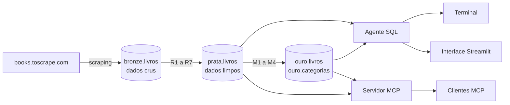

# 📚 Livraria Inteligente

Pipeline de dados em arquitetura medalhão (bronze, prata e ouro) e um **agente de IA que responde em português** perguntas de negócio, gerando e executando SQL com segurança.

A diretoria de uma livraria fictícia quer saber o que tem em catálogo, quanto vale o estoque e o que está bem avaliado. Hoje, cada pergunta vira um pedido ao time de dados. Aqui, ela é respondida em segundos, com o SQL à vista para conferência.

## Como funciona



| Camada | O que faz |
| :---- | :---- |
| **Bronze** | Guarda os textos exatamente como vieram do site. É append-only: cada execução insere de novo. |
| **Prata** | View em SQL puro que remove duplicidade por `upc` e converte preço, avaliação, estoque e reviews. |
| **Ouro** | Views em SQL puro com as métricas de negócio: valor em estoque, faixa de preço e livro bem avaliado. |
| **Agente** | Transforma a pergunta em um `SELECT`, executa no banco e responde em português. |
| **Servidor MCP** | Oferece o contexto, o schema e as consultas somente leitura como ferramentas para clientes MCP. |

## O diferencial: contexto

A cada pergunta, o agente recebe o [`PRD.md`](PRD.md) e o [`SPEC.md`](SPEC.md) inteiros, além do schema real do banco. As regras de negócio ficam nos mesmos documentos que guiaram a construção do pipeline.

O efeito aparece ao comparar os dois modos na mesma pergunta:

| Qual categoria tem o maior valor em estoque, em reais? | Com contexto | Com `--sem-contexto` |
| :---- | :---- | :---- |
| **Categoria** | `Nonfiction` | `Nonfiction`, mas com `Sem categoria` em 1º na tabela |
| **Câmbio** | R$ 7,20, definido no PRD | R$ 7,00, inventado pelo modelo |
| **Valor** | **R$ 231.287,47** ✅ | R$ 224.862,82 ❌ |

## Resultados

Respostas do agente com `claude-opus-5-5`, conferidas com um gabarito calculado direto em SQL, sobre 1.000 livros únicos:

| Pergunta | Resposta |
| :---- | :---- |
| Qual categoria tem o maior valor em estoque, em reais? | `Nonfiction`: R$ 231.287,47 |
| Quantos livros bem avaliados custam menos de £20? | 75 livros |
| Quantos livros únicos temos na base? | 1.000 |
| Qual o preço médio por faixa de preço? | até £20: £14,80 · £20–40: £30,06 · acima de £40: £49,91 |

## Segurança do agente

O SQL vem de um LLM, então ele é tratado como entrada não confiável:

- **Só leitura:** cada consulta roda em uma transação `read only`.
- **Validação antes de executar:** só um `SELECT` ou `WITH` por vez, com bloqueio de comandos de escrita e de funções perigosas.
- **Limites:** `statement_timeout` de 10 s e no máximo 50 linhas por consulta.
- **Bronze bloqueada:** com o contexto ligado, qualquer SQL que cite a bronze é recusado.
- **Correção assistida:** até 3 tentativas, com o erro devolvido ao modelo.

O servidor MCP usa os mesmos guardrails, e nele a bronze é sempre recusada.

## Servidor MCP

O servidor expõe três ferramentas por stdio, e cada descrição orienta o modelo sobre quando usá-la:

| Ferramenta | O que faz |
| :---- | :---- |
| `ler_contexto` | Devolve o `PRD.md` e o `SPEC.md`. Deve ser usada antes de escrever SQL. |
| `listar_schema` | Lista tabelas, colunas e tipos reais de prata e ouro. |
| `consultar` | Executa um `SELECT` de até 50 linhas e devolve também o SQL executado, para mostrar ao usuário. |

Testado com o cliente stdio oficial da biblioteca `mcp` e com `claude-opus-5-5` usando essas ferramentas. Sem instruções além das descrições, o modelo leu o contexto e chegou a `Nonfiction`, R$ 231.287,47, com o câmbio de 7,20 e sem `Sem categoria`.

## Stack

Python 3.14 · PostgreSQL no Supabase · `requests` · `beautifulsoup4` · `psycopg` · Streamlit · `mcp` · API da Anthropic ou da OpenAI

## Como rodar

1. Instale as dependências:

   ```bash
   python -m venv .venv
   .venv\Scripts\activate
   pip install -r requirements.txt
   ```

   No Linux ou macOS, ative com `source .venv/bin/activate`.

2. Copie `.env.exemplo` para `.env` e preencha:

   | Variável | Valor |
   | :---- | :---- |
   | `DATABASE_URL` | String de conexão do Postgres, com a senha sem colchetes |
   | `LLM_PROVIDER` | `anthropic` ou `openai` |
   | `LLM_MODEL` | Modelo a usar, como `claude-opus-5-5` |
   | `ANTHROPIC_API_KEY` ou `OPENAI_API_KEY` | Chave do provedor escolhido |

3. Carregue os dados e crie as views:

   ```bash
   python 01_scraper_bronze.py --paginas 50
   python aplicar_sql.py sql/01_prata.sql
   python aplicar_sql.py sql/02_ouro.sql
   ```

4. Use o agente:

   ```bash
   # Interface web
   python -m streamlit run app_streamlit.py

   # Terminal
   python 04_sql_agent.py "Quantos livros únicos temos na base?"

   # Terminal, sem o contexto, para comparar
   python 04_sql_agent.py --sem-contexto "Quantos livros únicos temos na base?"
   ```

Cada pergunta faz chamadas pagas à API do provedor escolhido.

5. Para usar o servidor MCP, copie o conteúdo de [`mcp_config.exemplo.json`](mcp_config.exemplo.json) para a configuração do seu cliente MCP e troque os caminhos pelos do seu projeto. O servidor lê a `DATABASE_URL` do `.env`, então nenhum segredo fica nesse arquivo.

   Para inspecionar as ferramentas, rode `mcp dev 05_mcp_server.py`, que exige Node.js.

## Estrutura

```
01_scraper_bronze.py   Raspa o catálogo e grava na bronze
aplicar_sql.py         Executa arquivos .sql e consultas
04_sql_agent.py        Agente SQL e guardrails
app_streamlit.py       Interface web do agente
05_mcp_server.py       Servidor MCP somente leitura
mcp_config.exemplo.json  Exemplo de configuração do cliente MCP
sql/                   Tabela bronze e views de prata e ouro
PRD.md                 O porquê: problema e decisões de negócio
SPEC.md                O como: regras, métricas e etapas
AGENTS.md              Regras para agentes de código neste projeto
```

## Situação do projeto

| Etapa | Situação |
| :---- | :---- |
| Scraping e bronze | ✅ |
| Prata | ✅ |
| Ouro | ✅ |
| Agente SQL e interface web | ✅ |
| Servidor MCP | ✅ |

**Limitações conhecidas**

- 9 dos 1.000 títulos têm caracteres com encoding incorreto, como `Shakespeareâ…s`. Isso não afeta os números.
- O repositório não tem uma suíte de testes automatizados. A validação segue os critérios de aceite de cada etapa do `SPEC.md`.
- O servidor MCP ainda não foi testado no MCP Inspector, no Claude Desktop nem no Claude Code.

## Sobre os dados

O catálogo vem do [books.toscrape.com](https://books.toscrape.com), um site público feito para treinar scraping. A livraria é fictícia, os dados são de demonstração e o câmbio de £1 = R$ 7,20 é um valor fixo definido para o projeto.
